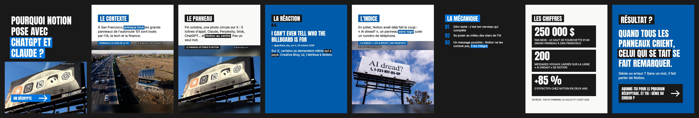
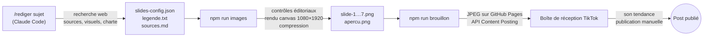

# Décrypte : générateur de carrousels TikTok sur le marketing

> *Comment ce produit, cette pub ou cette marque a fait sensation ?*
> Un outil qui transforme un cas marketing d'actualité en carrousel TikTok **sourcé**, **à la charte de la marque** et **prêt à publier**, en trois commandes.



**▶ Démo en ligne : [decrypte-marketing.vercel.app](https://decrypte-marketing.vercel.app)**. C'est le vrai studio en mode démo : mêmes écrans et données réelles, mais les actions qui appellent Claude, Metricool ou le moteur de rendu sont désactivées. Il est construit par `npm run demo:build` dans [`demo/`](demo/).

*Exemple réel : pourquoi Notion s'affiche avec ses concurrents de l'IA sur un panneau sans un mot (octobre 2026). 8 slides, sources citées, photos de la campagne.*

**Le compte :** [Derrière la Hype sur TikTok](https://www.tiktok.com/@derrierelahype)

---

## Le concept

Un compte TikTok qui décrypte le marketing derrière la culture pop : startups, food, tech, IA, jeux vidéo, sport, musique, streaming, retail, auto, jouets, voyage, créateurs. Chaque post décortique un cas réel pour en tirer **une leçon marketing**.

Trois rubriques tournent pour varier le fil :

| Rubrique | Part | Exemple |
|---|---|---|
| Le marketing derrière la culture pop | ~60 % | Une campagne virale, une startup qui explose sur TikTok |
| Pourquoi tu l'as acheté | ~25 % | Rareté, collection, prix psychologiques, effet de mode |
| Le flop | ~15 % | Bad buzz et ratés, analysés et sourcés, jamais moqueurs |

## Comment ça marche



1. **Recherche et rédaction** (`/rediger <sujet>` dans Claude Code). L'agent :
   - cherche le cas sur le web et lit les sources ;
   - récupère les visuels officiels (site de la marque, captures de la campagne) ;
   - relève les couleurs de la marque ;
   - rédige 6 à 8 slides, 3 variantes d'accroche, la légende et `sources.md`.
2. **Génération** (`npm run images`). Contrôle des règles éditoriales, rendu des PNG sans navigateur, compression, aperçu avec les zones masquées par TikTok.
3. **Envoi en brouillon** (`npm run brouillon`). Les slides passent par l'API officielle TikTok : elles arrivent dans la boîte de réception, jamais publiées automatiquement.

Pour préparer la semaine, `/lot 3` propose des sujets d'actualité qui respectent la variété du fil, puis rédige ceux que tu choisis.

## Les choix qui comptent

**Aucun chiffre inventé.**
- Chaque fait vient d'une source lue et notée dans `sources.md`.
- `npm run verifier` **bloque le rendu** si un nombre affiché sur une slide n'apparaît pas dans ce fichier.
- Pas de causalité non prouvée.

**La charte de chaque marque.** Couleurs relevées sur la charte officielle ou sur le site de la marque, et décrites dans un thème JSON. Le gabarit « poster » reste le même d'un post à l'autre : on reconnaît le compte, on reconnaît la marque.

**Lisibilité garantie.**
- Chaque combinaison texte/fond est vérifiée selon la norme d'accessibilité WCAG (contraste d'au moins 4,5:1).
- Rien d'important dans les 190 px du bas ni sur la colonne de droite, masqués par l'interface TikTok.
- `apercu-zones.png` montre ces zones en vert.

**Écrit pour TikTok.**
- Accroche de moins de 10 mots, moins de 25 mots par slide.
- Les mots-clés sont surlignés en blocs inversés.
- Typographie française (espaces insécables avant `? ! : %`).

**Un humain dans la boucle.** Tu choisis l'accroche, tu valides l'aperçu, tu ajoutes le son et tu publies toi-même.

**Variété du fil.** `calendrier.md` est régénéré à chaque étape et alerte si :
- deux posts d'affilée sont du même secteur ;
- les 10 derniers posts couvrent moins de 6 secteurs ;
- il y a moins de 2 startups sur 10 posts ;
- les rubriques s'écartent des 60/25/15 %.

## Démarrage

```bash
npm install
npm test
npm run verifier -- notion   # contrôles éditoriaux de l'exemple
npm run images -- notion     # régénère l'exemple (visuels bruts non versionnés : à récupérer via /rediger)
```

Pour l'envoi sur TikTok (appli développeur, sandbox, OAuth, GitHub Pages) : **[guides/tiktok.md](guides/tiktok.md)**.

Détourage automatique des produits (optionnel) : `npm run setup:rembg`, puis `"detourer": true` sur une photo.

## Le studio : tout l'outil dans le navigateur

```bash
npm run studio              # http://localhost:4321
npm run studio:installer    # (une fois) démarrage automatique à chaque session macOS
```

Le studio est le point d'entrée quotidien, sans terminal. Trois pages :

- **Veille.** Chaque matin, 8 sujets d'actualité et cas cultes, liés au marketing ou aux réseaux sociaux, avec leur angle, leurs chiffres et leurs sources. **Générer le slideshow** lance recherche, rédaction et rendu (5 à 15 min).
- **Posts.** La galerie des carrousels avec leur couverture, filtrable par statut, plus les alertes de variété du fil. Chaque post a sa page :
  - **Slides** : aperçu avec les zones TikTok, et un éditeur par slide (textes avec compteur de mots, variantes d'accroche, mots mis en valeur, visuels importés par glisser-déposer, cadrage, couleurs). Les slides s'ajoutent, se dupliquent, se déplacent et se suppriment. **Enregistrer et générer** (⌘S).
  - **Légende** : modifiable librement, ou **✨ Proposer 3 légendes** écrites par Claude à partir des slides.
  - **Sources** : rendu lisible ou modification à la main.
  - **Infos et couleurs** : rubrique, secteur, statut, et palettes de la marque avec sélecteurs de couleur et contrôle de lisibilité.
  - **Envoyer en brouillon** et **Marquer publié**.
- **Réglages.** La connexion TikTok en 3 étapes (clés, site GitHub Pages, bouton « Se connecter à TikTok »), l'heure de la veille et le démarrage automatique du studio.

Un post peut aussi être créé **à la main** : la structure est prête, il n'y a plus qu'à écrire et importer les images. Le panneau **Activité** suit en direct les tâches de Claude.

**Sous le capot :**
- Le serveur Node pilote Claude Code en mode non interactif (`claude -p`, sortie `stream-json`), avec une liste fermée d'outils autorisés. Il s'appuie sur l'abonnement Claude existant : aucune clé d'API.
- Les tâches Claude passent une par une dans une file d'attente.
- Le serveur n'écoute que sur `127.0.0.1`.

## Commandes

| Commande | Rôle |
|---|---|
| `npm run studio` | Interface visuelle locale (veille, rédaction, retouche, envoi) |
| `npm run studio:installer` | Lance le studio automatiquement à l'ouverture de session (`studio:desinstaller` pour annuler) |
| `npm run demo:build` | Reconstruit la démo statique du studio dans `demo/` |
| `npm run veille` | Veille du jour en ligne de commande |
| `/rediger <sujet>` *(Claude Code)* | Recherche, sources, visuels, thème de la marque, textes, rendu |
| `/lot <n>` *(Claude Code)* | Propose des sujets d'actualité variés, puis prépare les posts choisis |
| `npm run verifier -- <post>` | Contrôles éditoriaux seuls |
| `npm run images -- <post>` | Contrôles + PNG 1080×1920 + compression + aperçus |
| `npm run brouillon -- <post>` | Envoi du carrousel et de la légende dans la boîte de réception TikTok |
| `npm run publie -- <post>` | Marque le post comme publié |
| `npm run calendrier` | Régénère `calendrier.md` |
| `npm run tiktok:connexion` | Connexion OAuth (PKCE) |

`<post>` peut être un morceau du nom de dossier : `norway` suffit.

## Corriger une phrase

Tous les textes et réglages d'un post sont dans `posts/<date>_<sujet>/slides-config.json`. Tu modifies une phrase, une couleur ou le cadrage d'une photo (`focusY`), puis tu relances `npm run images`.

```jsonc
{
  "type": "text",
  "label": "L'idée",
  "body": "Dès le lundi soir, Visit Norway retouche une vieille page…",
  "highlight": ["une vieille page"],          // passe en bloc de couleur
  "photo": { "src": "images/capture-page-campagne.jpg", "caption": "…", "credit": "…", "focusY": 0.5 }
}
```

Types de slides : `hook`, `text`, `quote`, `list`, `stats`, `outro`.

## Structure

```
demo/               le studio en mode démo, statique (généré par npm run demo:build, déployé sur Vercel)
.claude/commands/   veille.md, rediger.md, lot.md : les méthodes de veille, de recherche et de rédaction
veille/             une veille par jour (JSON)
assets/             polices (Anton, Inter, licence OFL), thème par défaut
docs/               site GitHub Pages : médias pour TikTok, page de retour OAuth, CGU
guides/             guide TikTok pas à pas
posts/AAAA-MM-JJ_sujet/
  slides-config.json  legende.txt  sources.md  images/  slide-N.png  apercu*.png
src/
  cli.js            une commande par étape
  actions.js        actions communes au terminal et au studio
  editorial/        lecture des posts, règles éditoriales et vérification des sources
  render/           moteur de rendu : gabarits, texte surligné, typographie, contraste
  images/           compression PNG, export JPEG, détourage
  planning/         calendrier et règles de variété
  agent/            pilotage de Claude Code en mode non interactif
  studio/           serveur local, file de tâches, interface web (HTML/CSS/JS sans framework)
  tiktok/           OAuth, hébergement GitHub Pages, envoi en brouillon
tests/              règles éditoriales, typographie, contraste, variété
```

## Stack

- **Node.js 20+** (ESM, aucun framework)
- **@napi-rs/canvas** pour le rendu 2D natif, sans navigateur
- **sharp** pour la compression et l'export JPEG
- **Claude Code** (commandes personnalisées) pour la recherche web et la rédaction, avec Claude in Chrome pour les sites qui bloquent les téléchargements
- **API TikTok Content Posting** (OAuth 2.0 + PKCE, `MEDIA_UPLOAD`) et **GitHub Pages**
- **rembg** (optionnel) pour le détourage
- Tests avec `node:test`

## Limites connues

- Envoi photo TikTok limité aux URL d'un domaine vérifié, d'où GitHub Pages. Tant que l'appli n'est pas validée par TikTok, l'envoi peut exiger un compte privé (voir le guide).
- Les visuels des marques leur appartiennent : ils sont utilisés pour commenter un cas, avec la source citée, et ne sont pas versionnés.
- Les polices propriétaires des marques sont remplacées par Anton et Inter (Google Fonts, licence OFL).
